# Ninomae Home

An Android home screen for **any phone**, in the look of the [Ninomae shell](https://github.com/Doctoena/Ninomae-Shell): rounded squircles, joined pieces, frosted glass, and colours taken from your wallpaper.

It also has **foldable support**. On a foldable like the Galaxy Z Fold, the cover screen gets the phone layout and the big inner screen gets a desktop one, with a bar, a dock and app pairs. Each screen keeps its own grid, pages and settings.

<p align="center">
  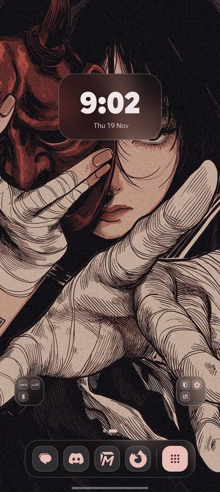
  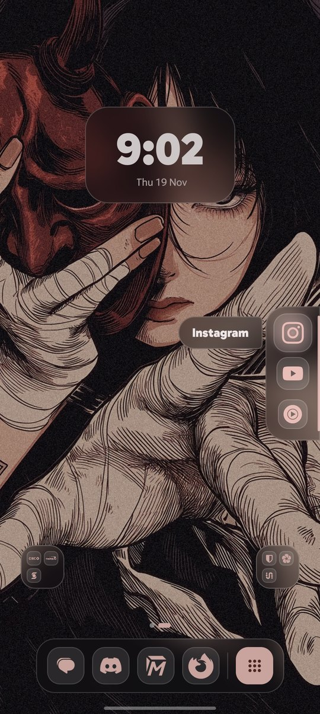
  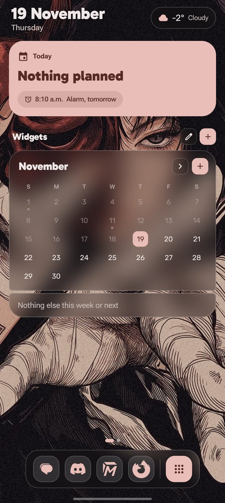
</p>

*Screenshots are from a phone-sized screen (a Galaxy Z Fold 7's cover screen).*

## Highlights

- **Frosted glass everywhere**: the dock, folders, menus, drawer and settings, all lined up with the wallpaper behind them.
- **An edge sidebar**: slide up along the edge, glide onto an app, lift to open it.
- **A search-first drawer** with your own tags, maths, contacts, calendar events, files and settings.
- **A widgets page** left of home, with your day at a glance and a calendar that fits the glass.
- **Themed icons** for every app, icon packs, and colours from your wallpaper.
- **Foldable aware**: a desktop on the inner screen, a phone on the cover, and each remembers where you were.

## Frosted glass

Samsung turns off Android's window blur, and Android won't let apps read your wallpaper. So you set the wallpaper from Ninomae (**Settings → Look → Wallpaper**). It keeps a frosted copy for the glass, a small preview, and the wallpaper's main colour for the theme. The drawer, settings, folders, dock, clock and menus are all frosted from it, lined up with where the wallpaper really is.

If you change the wallpaper in another app, Ninomae notices: the glass goes plain (it would show the old picture), and a note above the dock asks you to pick the new one here.

## The edge sidebar

<p align="center">
  
  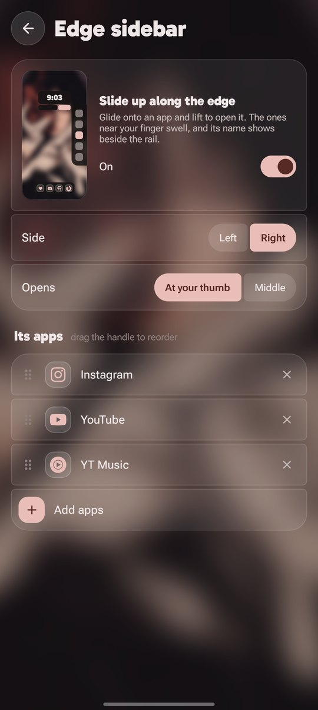
</p>

- **Slide up along the edge** of the home screen (left or right, your choice) and a slim glass rail of your own apps grows out of it, at your thumb or in the middle.
- Keep your finger down and glide: the app under it swells on a soft rose glow, its neighbours a little, and its name shows beside the rail. **Lift to open it**, or lift off the rail and tap.
- Its apps are its own, separate from the dock. Hold any app → **Add to edge**, or set it up in **Settings → Edge sidebar**: drag to reorder, pick apps, choose the side, or switch it off.

## The home screen and widgets

<p align="center">
  
  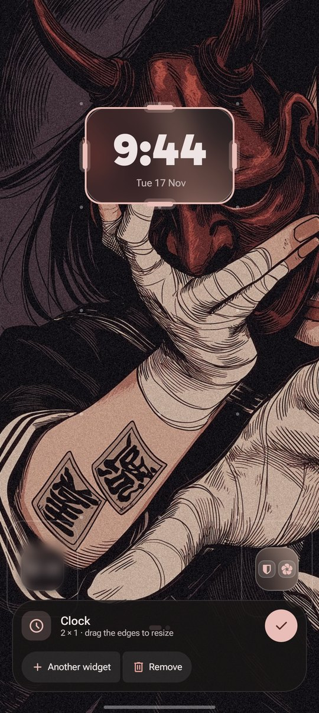
  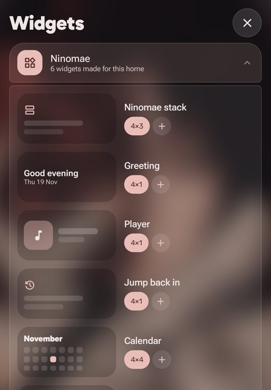
</p>

- **The widgets page**, left of your first home page: the date and weather, a rose **Today** card (what's next, and your alarm), the player when something plays, then your widgets, half or full width.
- **Hold an empty spot** to edit. Tap anything to pick it: drag its edges to resize it, and the bottom bar turns into its card (Rename, Unstack, Another widget, Remove). Hold and drag to move it, drop an app on another to make a folder, or drag it to the red **Remove** pill at the top.
- **Widgets**: every app's Android widgets, plus Ninomae's own:
  - **Clock**: a frosted slab with the time, the date, and an agenda of your next event, next alarm and the weather.
  - **Calendar**: this month, with this week and next listed under it.
  - **Ninomae stack**: a greeting with the weather, the player in rose, and your recent apps, joined in one card. Each also comes on its own.
- **Widget stacks**: drop one widget on another and swipe through them. **Big folders**: resize a folder to tap its apps straight from the home screen.

## The app drawer

<p align="center">
  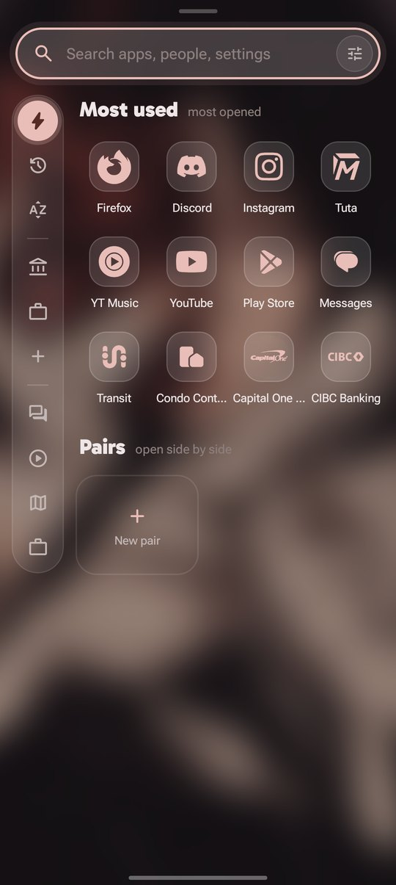
  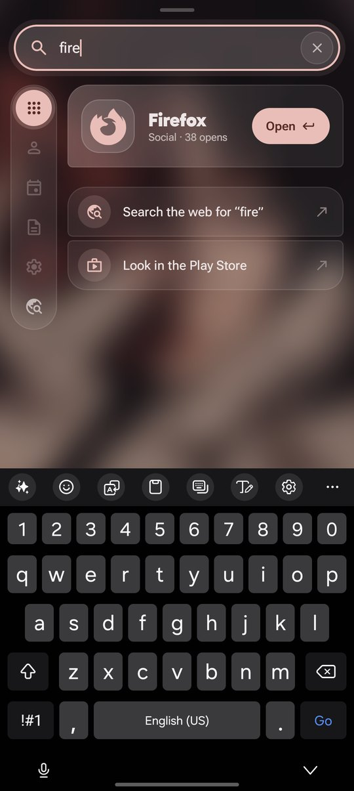
  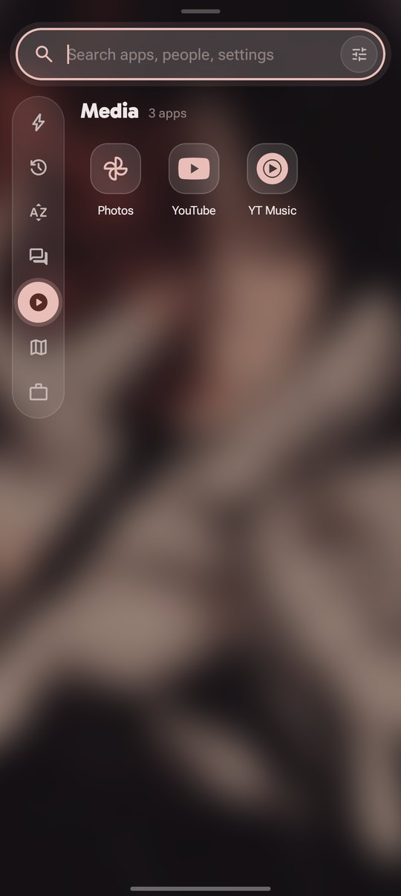
</p>

- **Swipe up** from anywhere. Search is at the top and **focused as it opens**, so you can type straight away. Enter opens the top match.
- A slim rail on the left: **Most used**, **Recent**, **A–Z** (with a letter scrubber), your own **tags** (hold an app → Tags, or **＋** in the rail), then groups made from the categories apps give Android (Social, Media, Games, Maps, Work…).
- While you type, the rail picks what to show: apps, people, calendar events, files (with All files access), settings, or the web.
- Search answers questions too: sums (`12*7`, `15% of 80`), conversions (`5 km to mi`), contacts (call or text), and Android settings pages by name.
- Swipe down on the list to close it. It follows your finger.

## Folders and the hold menu

<p align="center">
  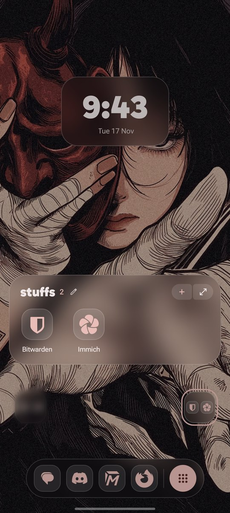
  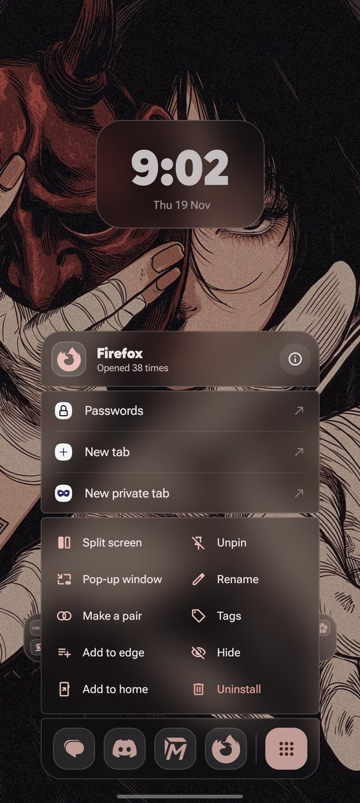
</p>

- A **folder** opens as a pane of frosted glass grown from its icon, four apps to a page. Tap the name to rename it, **＋** to tick apps in or out, and **↗** to see them all at once.
- **Hold an app** for its own shortcuts, then Split screen, Pop-up window, Make a pair, Add to edge, Pin, Rename, Tags, Hide and Uninstall. From the dock the menu joins onto it. In the drawer or a folder, it opens without closing them.
- **Rename** sits on the keyboard, with the app's own name one tap away.
- **Uninstalling** an app takes it off everywhere: home, folders, the dock, the edge, pairs and tags, and its widgets go too.
- **Notifications** show as a small rose bar under the app's icon, the same everywhere.

## App pairs

<p align="center">
  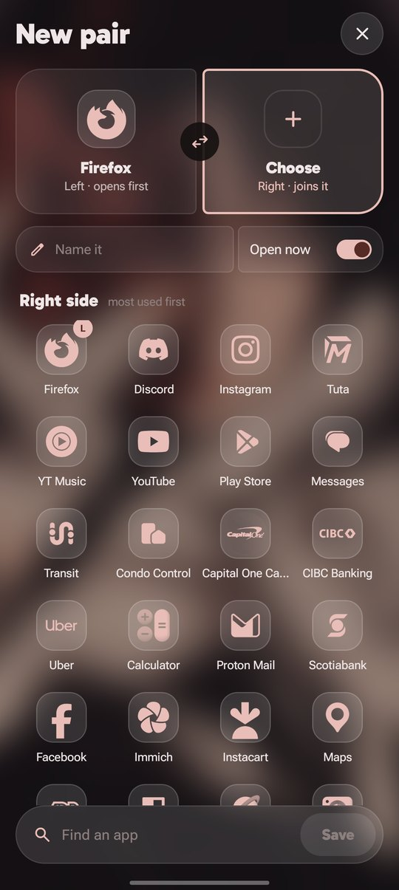
</p>

Two apps opened side by side in split screen, with one tap. Make one from the hold menu (**Make a pair**) or the drawer: tap a side, pick its app (most used first), name it, Save. On the inner screen your pairs sit in the bar.

## Settings

<p align="center">
  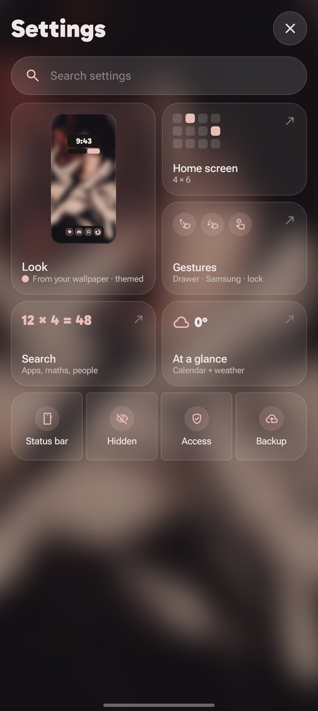
  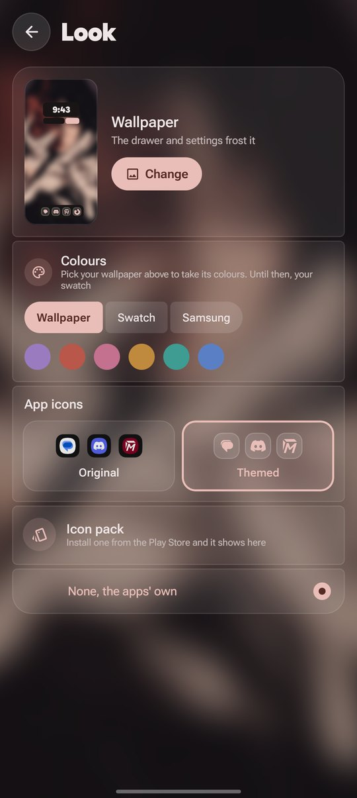
</p>

- Tiles that show what each part is set to, and a search for any setting.
- **Look**: the wallpaper, colours (from the wallpaper, a swatch, or Samsung's), **themed icons** for every app (apps without a monochrome icon get one made from their logo), and icon packs.
- **Home screen**: grid size per screen, app names, notification bars, the widgets page, lock the layout.
- **Gestures**: swipe down for the deck or Samsung's panel (per screen), double-tap to lock.
- **Edge sidebar**: see above.
- **At a glance**: your next calendar event, and the weather if you turn it on (Open-Meteo, rough location only).
- **Backup and restore** your whole home to a file.

## On big and unfolded screens

On a tablet-sized screen, like a foldable's inner screen, the layout becomes a desktop:

- A **bar** in place of the status bar, on glass and split around the camera: app pairs, the player, then status and the clock.
- A **wider dock** with your recent apps after the pinned ones.
- A **control deck** pulled down from the top: a rail of toggles (Wi-Fi, Bluetooth, location, Do not disturb, rotation, torch, screenshot, lock), the player tinted by its album art with brightness and volume, and notifications grouped by app.
- Folding or unfolding puts each screen back on the page it was on.

## Install

Download the APK from the [latest release](https://github.com/Doctoena/Ninomae-Home/releases/latest) and open it on your phone (Android 12 or newer). Android asks you to allow installs from wherever you opened it. Then make it your home app: Android asks the first time you press Home, or use **Settings → Access → Home app** in Ninomae.

## Build

Needs a JDK 17 or newer. The release build is the one to use day to day, since it's shrunk and much faster than a debug build:

```
./gradlew assembleRelease
adb install -r app/build/outputs/apk/release/app-release.apk
```

A release build is signed with your own key if `~/.gradle/gradle.properties` names one (`NINOMAE_STORE_FILE`, `NINOMAE_STORE_PASSWORD`, `NINOMAE_KEY_ALIAS`, `NINOMAE_KEY_PASSWORD`), and with the debug key otherwise. A build you make yourself can't update the one from Releases (they're signed differently), so uninstall one before installing the other.

## Access it asks for

| Access | For |
|---|---|
| Home app | Making it your home screen, and apps' own shortcuts |
| Notification access | The player, notifications and the rose bars |
| Accessibility | Split screen and pairs, lock, screenshot, power menu |
| Change system settings | Brightness and auto-rotate |
| Set wallpaper | Setting the wallpaper it frosts for the glass |

Contacts, calendar, files and location are only asked for when you turn on the feature that needs them.

## Licence

GPL-3.0, like [Ninomae-Shell](https://github.com/Doctoena/Ninomae-Shell). The bundled fonts keep their own licences: see [NOTICE.md](NOTICE.md).
